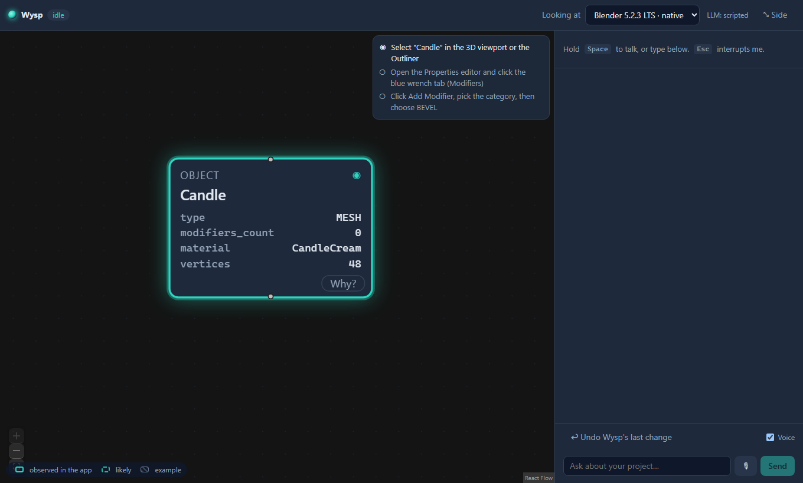

# Wysp

**A skeleton for building AI tutors for software applications.** A Wysp tutor observes the real state of an application, explains its concepts on an interactive visual board, guides the user through actions with permission, and verifies in the application what the user has learned. It works by voice, with a board, and through one adapter per application.

Wysp is our entry for **Kiroween 2026, category Skeleton Crew**. One shared core (Wysp Core) powers two very different tutors:

| Tutor | Folder | Integration level | Demo |
|---|---|---|---|
| Blender tutor | `apps/blender-tutor/` | native (Blender 5.2 Python API) | explain an object's modifier stack, add a Bevel with permission, verify it |
| Web tutor | `apps/web-tutor/` | interface (DOM and accessibility, Chrome MV3 extension) | explain a dashboard filter, guide the creation of a report, verify it |

> **Status (9 Nov 2026): working prototype of the first tutor.** The contract, the Core, the Panel and the Blender tutor run end to end (see "Run it"). The web tutor is next. Specs, steering, hooks and agents are in `.kiro/`.



## How it works

```
Blender extension ─┐                         ┌─ Panel (React): board, captions, voice, permissions
                   ├─ JSON-RPC / WebSocket ─ Wysp Core (Python) ─┤
Chrome extension ──┘   (adapter contract)    └─ LLM with tool calling, text-to-speech
```

- **Adapter contract**: `observe`, `get_context`, `get_actions`, `execute`, `undo`, `highlight`, events. Defined once as Pydantic models, exported to JSON Schema and TypeScript.
- **Trust rules**: every fact is labelled `observed`, `inferred` or `illustrative`; the LLM can only *propose* actions; a permission gate decides; every action is verified afterwards and undone if verification fails.
- **Contract Test Kit**: the same test suite runs against the mock adapter, the Blender tutor and the web tutor.

The full design (in French) is in [`docs/architecture/wysp-architecture.pdf`](docs/architecture/wysp-architecture.pdf). The normative specs (in English) are in [`.kiro/specs/`](.kiro/specs/).

## Run it (Windows, Blender 5.2 LTS)

Prerequisites: Python 3.13 with [uv](https://docs.astral.sh/uv/), Node 24, Chrome, Blender 5.2 LTS.

```powershell
uv sync                         # Python workspace
npm install; npm run build -w panel   # use npm.cmd if PowerShell blocks npm
copy .env.example .env          # optional: add a free GROQ_API_KEY (console.groq.com/keys) for a fast LLM
```

**1. Core + headless Blender (quickest)**

```powershell
scripts\dev_up.ps1                                   # Core on http://127.0.0.1:8765 + headless Blender with the demo scene
# offline and deterministic (no LLM account needed):
scripts\dev_up.ps1 -Llm scripted -Scenario apps\blender-tutor\demo\scenario.yaml
uv run python scripts\dev_chat.py                    # terminal Panel, or open http://127.0.0.1:8765
scripts\dev_down.ps1                                 # stop everything
```

**2. With the Blender interface**

```powershell
uv run python scripts\build_blender_extension.py --install   # builds and installs the extension
uv run wysp serve                                            # then in Blender: sidebar (N) > Wysp > Connect
```

Everything also works from inside Blender: the **Wysp** sidebar tab has the chat, permission prompts
(Approve / Deny / Allow for this lesson) and the guided steps, and **Open Board** shows the board as a node
tree in its own window (or in the Timeline area). Wysp can point at the interface itself: editors, viewport
regions and Properties tabs (`blender://ui/...` refs). Voice is in the browser Panel (http://127.0.0.1:8765).

**Logs and performance.** Each Core session and each Blender session writes a JSONL log to `~/.wysp/logs/`
(level `full` by default, `WYSP_LOG=off|basic|full`, `wysp serve --log ...`, or live from either Panel).

```powershell
uv run wysp logs list        # log files, newest first
uv run wysp logs summary     # latency (turns, LLM, tools, Blender queue), rate limits, guides, findings
uv run wysp logs timeline    # Core and Blender records merged in time order
```

**LLM providers.** `auto` picks the first of Groq, Cerebras, OpenRouter whose key is in `.env`, otherwise keyless
Pollinations (works, but stalls on about every second request). `--llm scripted` replays a scenario offline.

## Tests

```powershell
uv run pytest                                              # 48 tests: contract, Core, telemetry, end-to-end with the mock adapter, Blender Panel state
uv run pytest -m live -o addopts="" apps\blender-tutor\tests   # 4 tests inside a real headless Blender
npm test -w panel                                          # Panel unit and property tests
uv run python scripts\kiro\hook.py boundaries              # the Core must stay application-agnostic
```

## Build your own tutor in four steps (planned)

1. **Manifest**: id, integration level, capabilities, entity kinds, ref scheme.
2. **Observation**: map the application state to entities (the SDK gives you the client, state digest and validation).
3. **Actions**: one file per action with params schema, risk level, postconditions and UI path.
4. **Profile**: skills, concepts, lessons and exercises in YAML.

Then `uv run wysp-contract --tutor <name>` tells you whether your adapter is compliant. No change to the core or the Panel is needed.

## How we use Kiro

| Kiro feature | Where | What it does for us |
|---|---|---|
| Specs | `.kiro/specs/` | 6 specs (contract, core, pedagogy, panel, Blender tutor, web tutor): 52 EARS requirements, 49 correctness properties, 71 tasks with owner and milestone |
| Steering | `.kiro/steering/` | product vocabulary, structure and boundaries, trust and safety, testing, contract guide, pedagogy, UI design system, demo and release checklists |
| Hooks | `.kiro/hooks/` | core boundary guard, schema sync, offline contract checks, trust review, new-action integration, formatting, profile validation, tests after each task |
| Agents | `.kiro/agents/` | `blender-adapter`, `browser-adapter`, `contract-guardian` (read-only reviewer) |
| MCP | `docs/kiro/mcp.example.json` | Context7 (up-to-date docs), Playwright, and later a read-only bridge to a running tutor |

Hooks call `scripts/kiro/hook.py`, a standard-library Python script that CI runs too.

## Getting started

See "Run it" above.

## Repository layout

```
.kiro/          specs, steering, hooks, agents
core/           Wysp Core (Python)
contract-tests/ Contract Test Kit and mock adapter
sdk/            adapter SDKs (Python, TypeScript)
panel/          shared React Panel
apps/           blender-tutor/, web-tutor/
docs/           architecture document, adapter guide, Kiro journal
scripts/        dev scripts and the Kiro hook dispatcher
```

## License

MIT (see `LICENSE`). The Blender extension in `apps/blender-tutor/adapter/` will be licensed GPL-3.0-or-later, as required for Blender add-ons.
